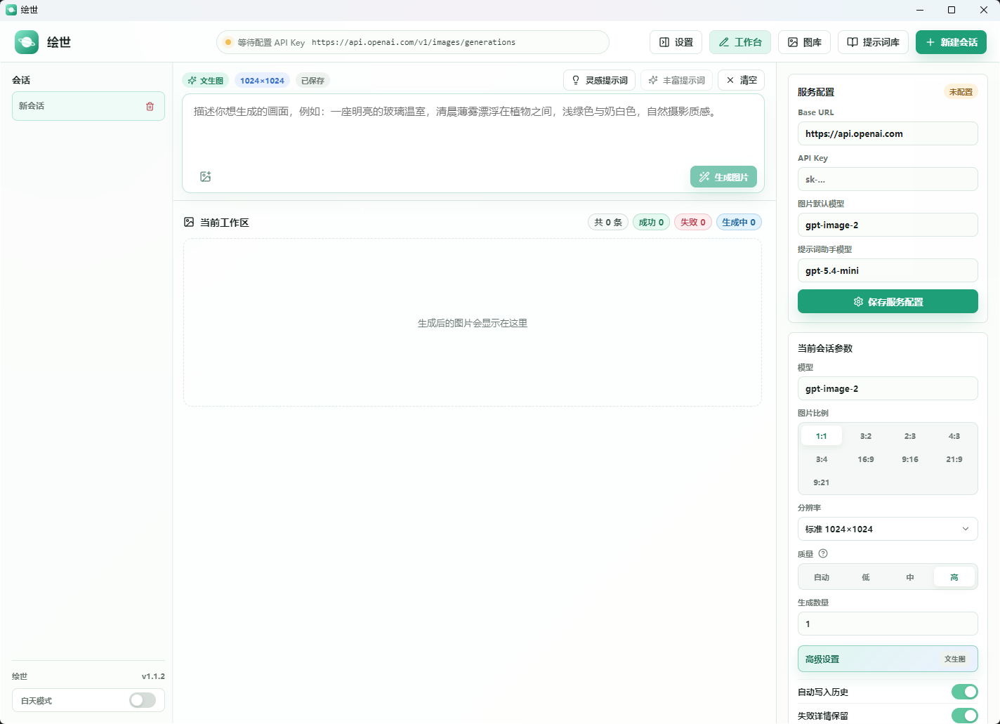

# 绘世 PictVerse

绘世（PictVerse）是一个桌面图片生成工作台，支持 Windows 和 macOS，使用 Electron、React 和 TypeScript 构建，支持接入 OpenAI-compatible 图片生成接口。

它面向本地化的 AI 绘画工作流：在多会话中管理提示词、参考图和生成参数，将生成结果保存到本地 SQLite 历史库，并提供图库检索、预览、收藏、复制、下载和参数回填。

## 界面截图

### 控制台



### 预览

> 待补充。

### 图库

> 待补充。

## 功能特性

- OpenAI-compatible 接口：配置 `baseURL`、`apiKey`、图片模型和提示词辅助模型。
- 文生图与图生图：支持会话参考图，调用 `/v1/images/generations` 和 `/v1/images/edits`。
- 多会话工作台：每个会话独立保存 prompt 草稿、模型、比例、尺寸、质量、数量和高级参数。
- 提示词库：内置场景模板，可检索、复制并一键套用到当前会话。
- 并发生成与单图取消：当 `n > 1` 时并发请求，单张完成后立即写入历史并更新工作区。
- 提示词辅助：支持一键生成灵感提示词，并对当前提示词进行丰富和优化。
- 本地图库：支持搜索、排序、筛选、收藏、删除、批量下载、作为参考图图生图和参数回填。
- 图片预览：支持智能缩放、滚轮缩放、拖拽平移、左右切换、复制、下载和系统全屏。
- 本地持久化：使用 SQLite 保存会话、生成轮次和图片历史，生成图片保存到本地文件夹。
- 桌面体验：支持白天/黑夜主题、可收起设置面板、可拖拽调整会话栏宽度。
- 内置 MCP 服务：把自身暴露成 MCP Server，外部 agent 可直接读取会话、生成图片、检索图库。

## 技术栈

- Electron 34
- Electron Vite
- React 19
- TypeScript 5
- Zustand
- better-sqlite3
- Model Context Protocol SDK
- Vitest
- electron-builder

## 环境要求

- Windows 10 或更高版本，支持 x64 与 ia32 安装包
- macOS 13 或更高版本，支持 Intel x64 与 Apple Silicon arm64 安装包
- Node.js 22 或兼容版本
- pnpm 10
- 可用的 OpenAI-compatible API Key

项目声明的包管理器为：

```text
pnpm@10.26.2
```

## 快速开始

安装依赖：

```powershell
pnpm install
```

启动开发环境：

```powershell
pnpm dev
```

`pnpm dev` 会先按当前系统架构重建本地原生依赖，避免在切换过 x64 / ia32 打包后出现模块架构不匹配。

打开应用后，在右侧设置面板填写：

- `baseURL`：默认 `https://api.openai.com`
- `apiKey`：图片生成服务的 API Key
- 默认图片模型：默认 `gpt-image-2`
- 提示词辅助模型：默认 `gpt-5.4-mini`

## 常用脚本

```powershell
pnpm dev      # 启动 Electron + Vite 开发环境
pnpm test     # 运行单元测试
pnpm build    # TypeScript 检查并构建主进程、preload、renderer 和 stdio 桥
pnpm build:mcp-bridge  # 只构建 stdio 桥到 dist-mcp/
pnpm preview  # 预览已构建应用
pnpm dist     # 构建当前平台安装包
```

安装包输出到：

```text
dist/
```

Windows 安装包文件名会包含架构后缀，例如：

```text
PictVerse Setup 1.1.2-x64.exe
PictVerse Setup 1.1.2-ia32.exe
```

macOS 安装包文件名会包含平台和架构后缀，例如：

```text
PictVerse-1.1.2-mac-x64.dmg
PictVerse-1.1.2-mac-arm64.dmg
PictVerse-1.1.2-mac-x64.zip
PictVerse-1.1.2-mac-arm64.zip
```

## 发布 Releases

GitHub Releases 由 `.github/workflows/release.yml` 自动完成。

1. 更新 `package.json` 里的版本号。
2. 创建并推送 tag：

```powershell
git tag v1.1.2
git push origin v1.1.2
```

也可以在 GitHub Actions 页面手动运行 workflow，并填写 `tag`。

workflow 会自动：

- 运行测试和构建检查
- 分别打包 Windows `x64` / `ia32` 安装包
- 分别打包 macOS `x64` / `arm64` 安装包
- 将安装包和 Windows blockmap 上传到对应 GitHub Release

生成的 Release 资产包含：

```text
PictVerse Setup <version>-x64.exe
PictVerse Setup <version>-ia32.exe
PictVerse-<version>-mac-x64.dmg
PictVerse-<version>-mac-arm64.dmg
PictVerse-<version>-mac-x64.zip
PictVerse-<version>-mac-arm64.zip
```

## 本地数据

开发环境下，数据保存在项目根目录的 `data/` 目录。Windows 打包安装后，数据保存在安装目录同级的 `PictVerse-data/` 目录，例如安装到 `D:\Apps\PictVerse` 时数据目录为 `D:\Apps\PictVerse-data`；macOS 打包后，数据保存在应用的用户数据目录下。

从旧版本升级时，如果发现旧的 `安装目录\data` 存在且新的 `PictVerse-data/` 尚未初始化，应用会在启动时自动迁移旧数据，避免安装新版时清空历史。

```text
data/
├─ settings.json
├─ pictverse.sqlite
├─ mcp.ndjson
├─ images/
└─ reference-images/
```

- `settings.json`：服务配置和 API Key 存储状态。
- `pictverse.sqlite`：会话、生成轮次、图片历史和参考图索引。
- `images/`：生成后的图片文件。
- `reference-images/`：导入或从历史复制出的参考图文件。
- `mcp.ndjson`：MCP 调用日志，最多保留最近 500 条，可在设置页清理。

API Key 会优先使用 Electron `safeStorage` 加密保存；当系统不支持加密时，会降级保存到本地设置文件，应用会在界面中提示该状态。

## 项目结构

```text
src/
├─ main/          # Electron 主进程、IPC、SQLite、设置、图片请求、文件处理
│  └─ mcp/        # 内置 MCP 服务：HTTP 端点、15 个工具、日志与配置片段
├─ mcp-bridge/    # stdio 桥：把 stdio 上的 MCP 请求转发到本机 HTTP 端点
├─ preload/       # 安全暴露给 renderer 的 window.pictverse API
├─ renderer/      # React 前端界面
└─ shared/        # 主进程、preload、renderer 共享类型与工具

docs/             # 设计方案与实现总结
data/             # 开发环境本地数据，未纳入版本控制
out/              # 构建输出
dist-mcp/         # stdio 桥构建产物，未纳入版本控制
dist/             # 安装包输出
```

## 接口配置

PictVerse 默认按 OpenAI-compatible 规范请求：

```text
POST {baseURL}/v1/images/generations
POST {baseURL}/v1/images/edits
POST {baseURL}/v1/responses
```

图片生成请求由当前会话参数决定，包括 prompt、模型、尺寸、质量、输出格式、背景、审核等级、流式参数和参考图。提示词辅助功能使用 `/v1/responses`。

## MCP 服务（连接外部 Agent）

绘世可以把自己暴露成一个 [MCP](https://modelcontextprotocol.io) Server，让 Codex、Claude Code、Cursor 这类 agent 直接读会话、生成图片、检索图库，不用来回切窗口。

### 开启

设置 → **MCP 服务** → 打开「启用服务」。默认监听 `127.0.0.1:27810`，端口可在同一页修改。

- 只绑定本机回环地址，局域网访问不到；
- 所有请求需要 Bearer token，可在设置页显示、复制、重置；
- 端口被占用时自动顺延并回写配置，不会静默失败。

### 工具

| 分组 | 工具 |
|---|---|
| 会话 | `list_conversations`、`get_conversation`、`create_conversation`、`update_conversation` |
| 生成 | `generate_image`、`get_run`、`cancel_run` |
| 图库 | `list_images`、`get_image`、`favorite_images`、`delete_images`、`export_images` |
| 素材 | `import_reference`、`optimize_prompt` |
| 配置 | `list_models` |

几个约定：

- `generate_image` 不会阻塞到出图。`wait_seconds`（默认 25，上限 60）内完成就直接返回图片，超时返回 `run_id`，由 agent 用 `get_run` 轮询。
- 单个进程最多 4 个在途生成，超出直接返回可读错误，不排队。
- `get_image` 默认内联一张最长边 512 的缩略图，原图按返回的 URL 自取，避免撑爆上下文。
- 供应商 API Key 不会出现在任何 MCP 响应里，只给「是否已配置」。

### 客户端配置

页面里有 5 份可直接复制的片段：Codex 与 Claude Code 各一份 **stdio** 与一份 **HTTP**，外加通用 HTTP。

- **stdio** 兼容性最好，适合只认 stdio 的客户端。命令用软件自身的可执行文件配合 `ELECTRON_RUN_AS_NODE`，用户不需要额外装 Node。
- **HTTP** 适合已支持 Streamable HTTP 的客户端，少一个进程。
- 片段里的路径按**当前安装位置**生成；移动安装目录后重新复制一次即可。

### 日志

设置页的调用日志按每页 20 条分页，点任意一行可展开详情（时间、耗时、客户端、入参摘要、错误原文），支持「只看失败」与二次确认清空。日志同时写入 `data/mcp.ndjson`。

## 测试与质量

运行全部测试：

```powershell
pnpm test
```

运行构建检查：

```powershell
pnpm build
```

当前测试覆盖了图片参数构造、生成进度、取消逻辑、错误详情、设置存储、历史筛选、工作区摘要、预览元数据和批量下载等核心逻辑；MCP 部分另有 51 项，覆盖工具参数收敛、供应商密钥脱敏、HTTP 端点鉴权与 Host 校验、日志分页与落盘、stdio 桥配置与路径解析。

## 文档

- [设计方案](docs/设计方案.md)
- [实现总结](docs/实现总结.md)

## 贡献

欢迎通过 Issue 或 Pull Request 反馈问题和改进建议。

建议在提交前运行：

```powershell
pnpm test
pnpm build
```

提交 PR 时请说明：

- 变更目的
- 主要实现方式
- 测试结果
- 可能影响的数据或配置

## 许可证

本项目采用 [PolyForm Noncommercial License 1.0.0](LICENSE)。

你可以将本项目用于个人学习、研究、实验和非商业二次开发。未经 PictVerse 明确书面授权，不得将本项目或其衍生作品用于商业用途。

该许可证包含非商业限制，因此本项目属于 source-available 软件，不属于 OSI 定义下的开源软件。如需商业授权，请通过 GitHub 联系 [@xxxxxgold](https://github.com/xxxxxgold)。
